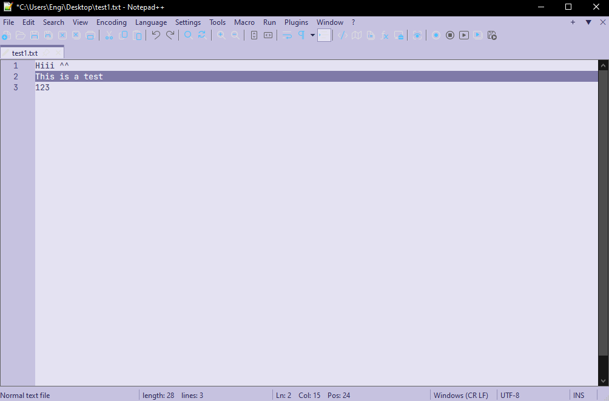

# Lavender Notepad++ Theme

A light violet and purple lavender inspired theme for Notepad++ (I did it in like 4 hours and this is my first ever project) :<

## Preview

## Features

- A full out change of the appearance 
- Minimalist, low-distraction appearance and cute af
- Changes more than just the theme so it all fits good

## Installation

1. Download `Lavender.xml` from this repository.
2. Download and install the `JetBrainMono` font (by double clicking and clicking install on the left-top corner).
3. Download `CurrentLineTextColor.zip`, it's a plugin that makes stuff much better.
4. Go to C:\Users\YOUR_NAME\AppData\Roaming\Notepad++\themes and put `Lavender.xml` in there.
5. Go to C:\Program Files\Notepad++\plugins put the `CurrentLineTextColor.zip` and extract it there,
6. from inside the folder select x64 or x86 based on your machine and arrange the files so it looks like this "C:\Program Files\Notepad++\plugins\CurrentLineTextColor\CurrentLineTextColor.dll".
7. Now open Notepad++ and go to Settings -> Style Configurator... -> Select Theme: -> `Lavender.xml`.
8. Under Styles find "Global Override", select JetBrains Mono in the font name box, font size 10, and check "force Backround" and "force Foreground" as well as "font choice" and "font size".
9. go to Settings -> Preferences... -> Dark Mode -> acctivate dark mode and click on the circle next to "Customized" and follow the `Color Palette` bellow 
    

## Color Palette

| Setting | Preview | Hex | RGB |
|:--|:--:|:--:|:--|
| Content background |  | `#C6C2E0` | `198, 194, 224` |
| Hot track item |  | `#B5B0D8` | `181, 176, 216` |
| Control background |  | `#E4E2F2` | `228, 226, 242` |
| Dialog background |  | `#C6C2E0` | `198, 194, 224` |
| Error |  | `#A4577F` | `164, 87, 127` |
| Text |  | `#2E2B58` | `46, 43, 88` |
| Darker text |  | `#55518A` | `85, 81, 138` |
| Disabled text |  | `#8581AD` | `133, 129, 173` |
| Link |  | `#4B4780` | `75, 71, 128` |
| Edge |  | `#9390B8` | `147, 144, 184` |
| Edge highlight |  | `#6A6599` | `106, 101, 153` |
| Edge disabled |  | `#BAB6D8` | `186, 182, 216` |

If you have any problems with the theme or any questions or ANYTHING you want to tell me, here's my discord: engi_901
feel free to contact me ^^

I will probably make a video tutorial but yall need to wait

## Credits

Created by Engi.
